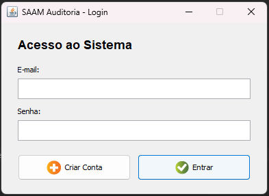
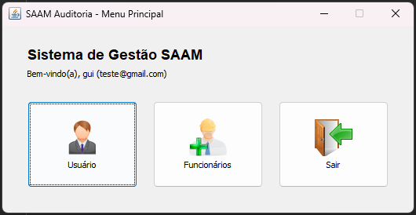
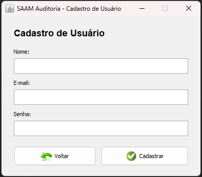
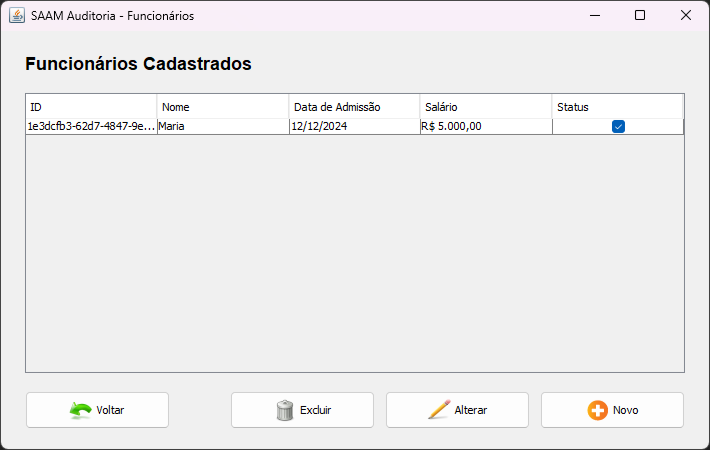

# Teste Técnico — Java Desktop (Swing + PostgreSQL)

## Descrição

Aplicação desktop desenvolvida como parte de um teste prático para demonstrar competências em **Java**, interface gráfica com **Java Swing** e persistência em banco de dados relacional **PostgreSQL**. O sistema permite o cadastro e gerenciamento de usuários e funcionários, com recursos de autenticação e visualização de dados em tabelas.

Este projeto foi estruturado seguindo práticas da arquitetura **MVC** e padrão **DAO**, garantindo manutenibilidade, separação de responsabilidades e facilidade de evolução.

Autor: Guilherme Mathias

## Funcionalidades

### Tela de Login

Autenticação de usuários cadastrados no sistema, validando credenciais com feedback visual.



### Menu Principal

Menu princípal mostrando o usuário conectado e fornecendo atalhos aos módulos do sistema.



### Cadastro de Usuários

Formulário para registro de novos usuários, com validação de dados obrigatórios, unicidade de e-mail e armazenamento de senhas utilizando SHA-256.



### Cadastro de Funcionários

Módulo para cadastro, consulta, alteração e exclusão de funcionários, com visualização organizada através de tabela e formatação monetária e de datas.



## Tecnologias Utilizadas

- **Java 21**
- **Java Swing** (compatível com NetBeans 14 GUI Builder)
- **PostgreSQL 16** (Driver JDBC `org.postgresql:postgresql`)
- **Apache Maven**
- **JUnit 5** (Testes automatizados)
- **Docker & Docker Compose**

## Pré-requisitos

- **JDK 21** instalado e configurado no `PATH`
- **Apache Maven** (ou utilize o Maven embutido no NetBeans 14)
- **PostgreSQL** em execução (via **Docker** ou instalação local)

## Execução

### 1. Clonagem do Repositório

```bash
git clone https://github.com/Guimathis/teste-tecnico-swing.git
cd teste-tecnico-swing
```

### 2. Configuração do Banco de Dados

A aplicação se conecta por padrão em `jdbc:postgresql://localhost:5432/saam_db` (usuário `postgres` e senha `postgres`), criando automaticamente as tabelas necessárias (`usuarios` e `funcionarios`) na inicialização através do script `src/main/resources/sql/schema.sql`.

#### Opção 1: Subir o banco via Docker (Recomendado)

Na raiz do projeto clonado, execute:

```bash
docker compose up -d
```

#### Opção 2: Usar PostgreSQL Local

Caso utilize uma instância local do PostgreSQL, certifique-se de que o banco `saam_db` exista:

```sql
CREATE DATABASE saam_db;
```

> Ou utilize o script em `src/main/resources/sql/create-database.sql`

Se desejar customizar as credenciais ou porta, defina as variáveis de ambiente antes de iniciar a aplicação:

- `DB_URL` (padrão: `jdbc:postgresql://localhost:5432/saam_db`)
- `DB_USER` (padrão: `postgres`)
- `DB_PASSWORD` (padrão: `postgres`)

### 3. Execução da Aplicação

Pelo terminal (Maven):

```bash
mvn compile exec:java
```

Ou abra o projeto diretamente no **NetBeans 14** (`File > Open Project > testeTecnicoSwing`) e pressione **F6 (Run Project)**.

## Executando os Testes

```bash
mvn clean test
```
